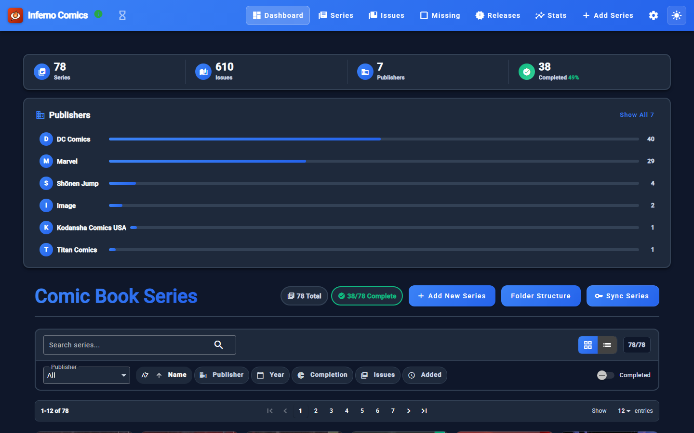
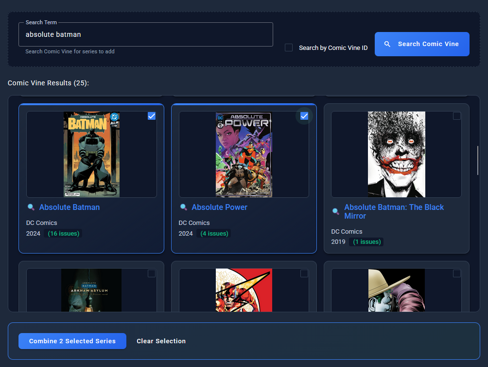
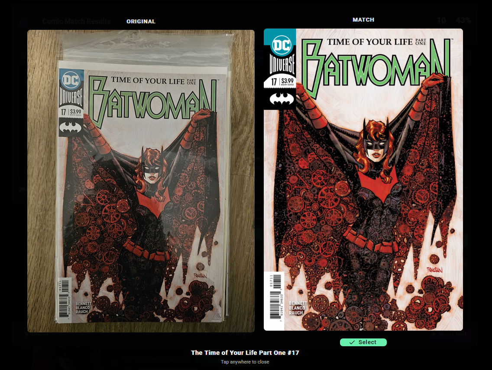
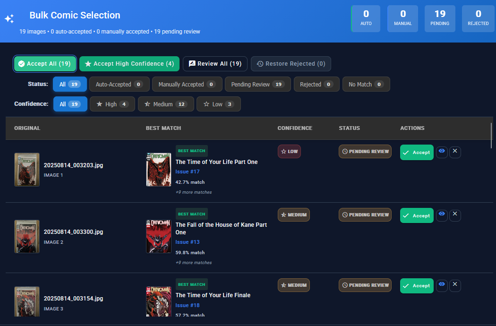
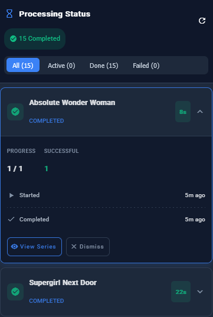
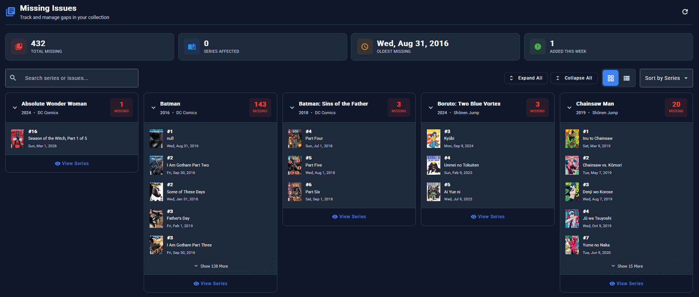
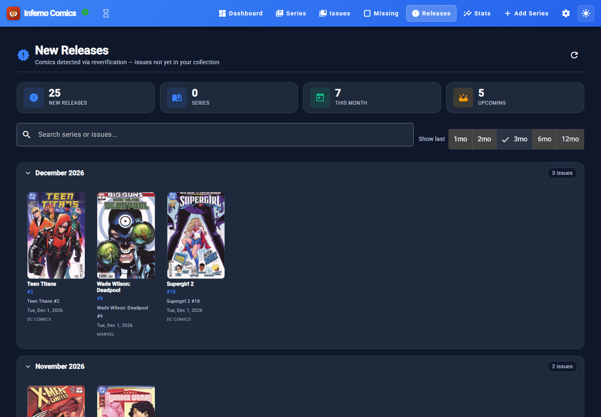
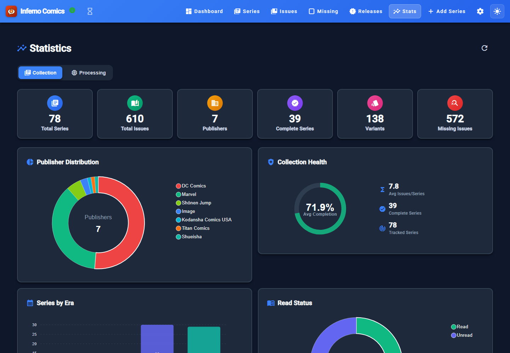

Inferno Comics tracks my comic collection: what I own, what I'm missing, and what's coming out. Most of it is DC, with some Marvel and manga. The point of it is that adding comics is mostly taking photos instead of typing in every issue.

It runs on my home server. The source is private, and these screenshots are from my own instance.

## Adding a series

Series come from [Comic Vine](https://comicvine.gamespot.com/). Search, tick the results you want, and they're added with their issue lists, covers and dates. Several results can also be combined into one series.

## Adding issues by photo

Take photos of your comics, upload them, and the recognition service compares each photo against the covers of every issue in the series.

It uses OpenCV's AKAZE feature matching, which works from distinctive points in the image rather than the whole picture, so a comic still in its bag and photographed on a table can be matched. Each result comes with a confidence score.

With a whole stack of photos you get a bulk review. High-confidence matches can be accepted in one go, and the rest you check by hand.

Matching runs in the background, and you can watch each job's progress.

## Tracking the gaps

With the issue lists from Comic Vine, the app knows what you don't have. The Missing page lists every gap by series.

Series get reverified every so often, and new issues that turn up land on the Releases page, grouped by month.

The Stats page has the overall picture. Right now that's 78 series and 610 issues across 7 publishers.

## How it's built

- **Web:** Angular 21 with NgRx, AG Grid and Angular Material.
- **API:** Spring Boot 3.5 on Java 25, with PostgreSQL 17 and Redis. Long jobs report progress over server-sent events.
- **Recognition:** a Python Flask service using OpenCV, with a SQLite cache.
- **Extras:** Comic Vine for metadata, an AI model through Groq for series descriptions, and Nextcloud for syncing files. There's also an Android app, and a tool that imports the [Grand Comics Database](https://www.comics.org/) for extra series and issue data.

Each service is its own Docker image, built by my GitLab and published to Docker Hub.
