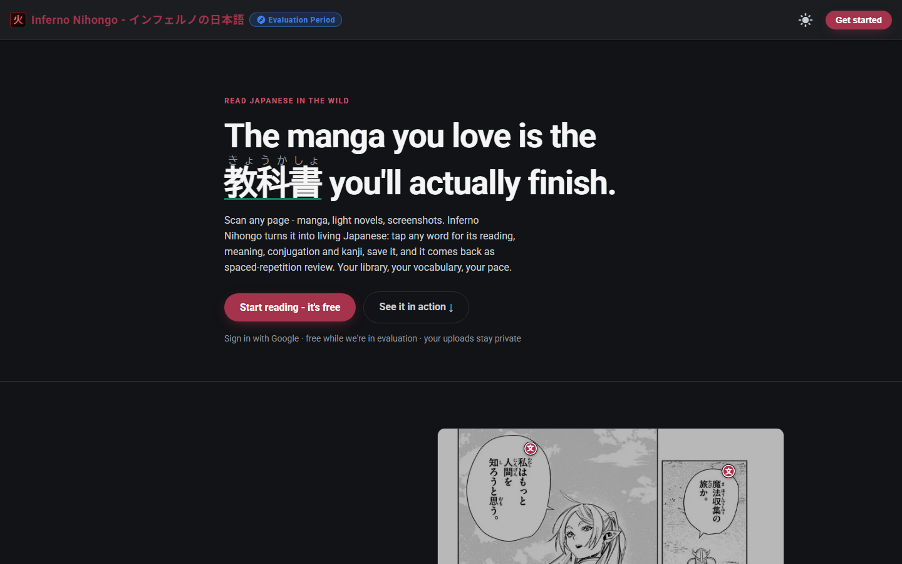
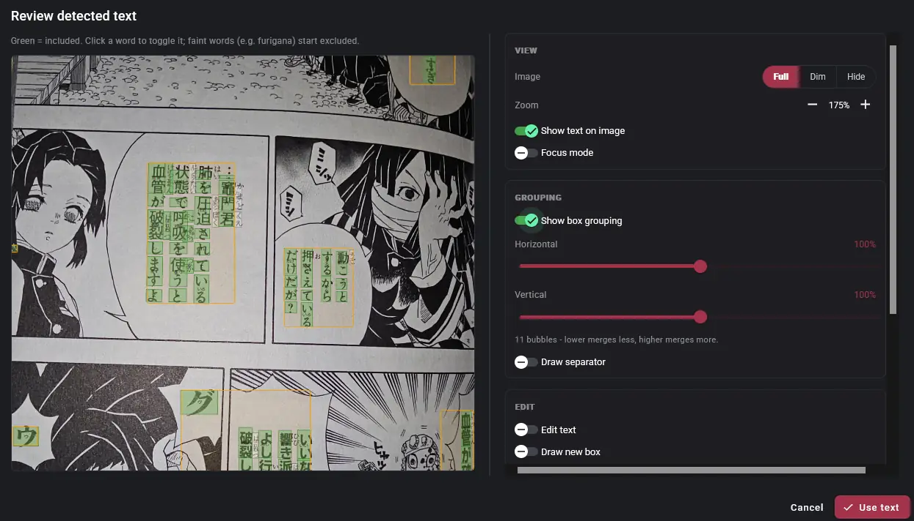
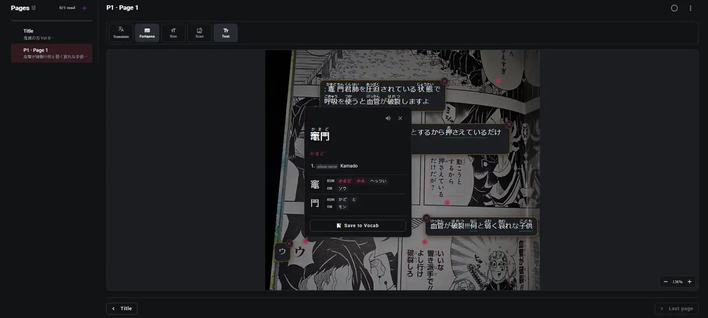
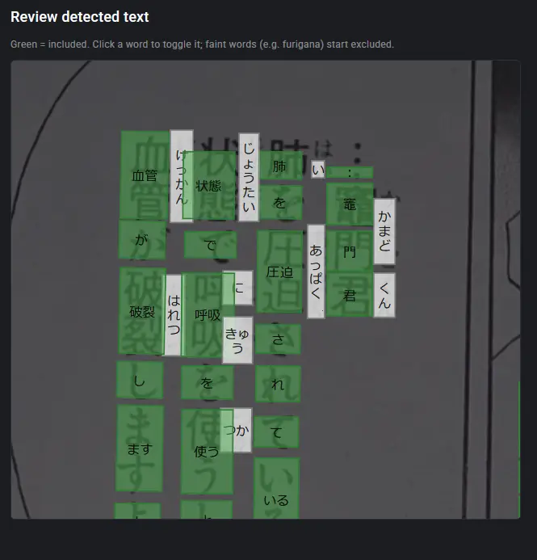
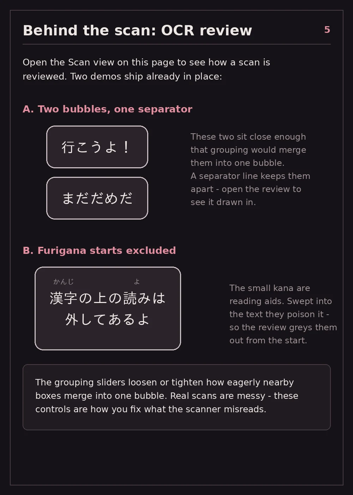

Inferno Nihongo turns real Japanese, like manga, light novels and screenshots, into study material. Point it at a page, read it with help, and the words you looked up come back for review. No generic decks: you review the words you actually met.

Inferno Nihongo (インフェルノの日本語) is live at [japan.infernokun.com](https://japan.infernokun.com/). It's free while it's in an evaluation period, and you sign in with Google. The source is private.

## Scan

Photograph a page, or upload a screenshot, a PDF or a CBZ. OCR finds the text, including vertical text, rotated pages and speech bubbles, and rebuilds it as real text with the reading order fixed.

Real scans are messy, so before anything is saved you see exactly what it found. Every word is boxed on the image. You can drop false positives, fix a reading, and tune how eagerly nearby boxes merge into one speech bubble. Furigana is left out by default, because those little reading aids get swept into the text and ruin it.

## Read

Once a page is in your library, every word is tappable. A tap shows the reading, meanings, the conjugation broken down (dictionary form plus passive plus past, and so on), JLPT level, frequency rank, WaniKani progress, the kanji with their readings and parts, example sentences, and where else in your library the word shows up.

Words you've saved are underlined green. Words you saved from a different series show orange, so you can see your vocabulary following you from book to book.

Text-heavy pages get a page reader instead, with furigana above only the kanji you don't know yet.

## Remember

Saved words go into spaced-repetition review. If you already know a word you can mark it known right from the reader. A built-in getting-started book walks through all of this, including how a scan is reviewed.

## How it's built

It's four services, all in Docker:

- **Web:** Angular 22 with TypeScript and SCSS.
- **API:** Spring Boot 3.5 on Java 25, with PostgreSQL and Redis. The Japanese analysis lives in its own Gradle module called `hibana` (火花, "spark"): the tokenizer, bundled JMdict, JMnedict, KANJIDIC2 and Tanaka example data, and the dictionary ranking. It has no database, HTTP or auth in it, so it can be tested on its own.
- **Translate:** a Python FastAPI service for OCR, furigana, translation, and rendering pages out of PDFs and CBZs.
- **Mobile:** a Flutter app for Android and iOS that talks to the same API as the web app, with an offline mode.

My own GitLab builds and tests everything and pushes the images to my own registry. Next to test coverage for each service, the pipeline reports a reader accuracy score and an answer accuracy score, so a change that makes either one worse shows up before it ships.
