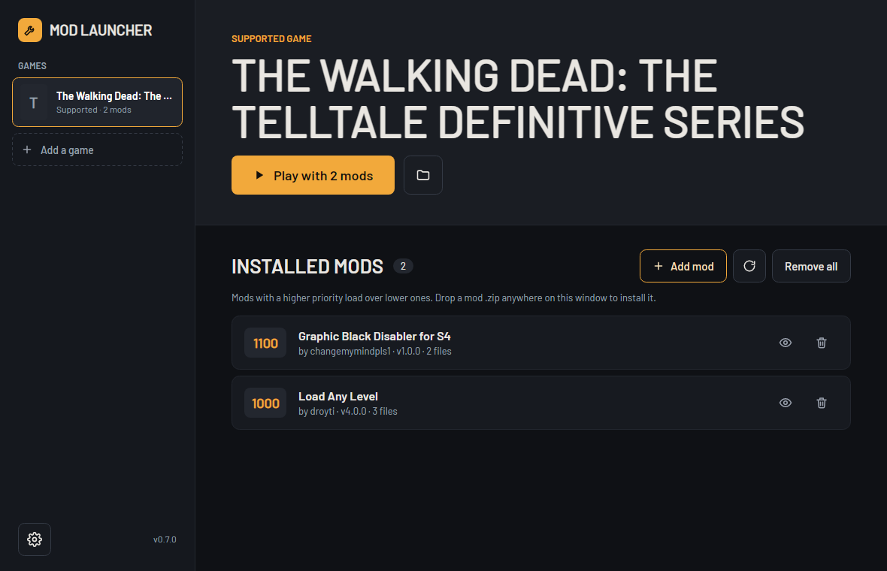
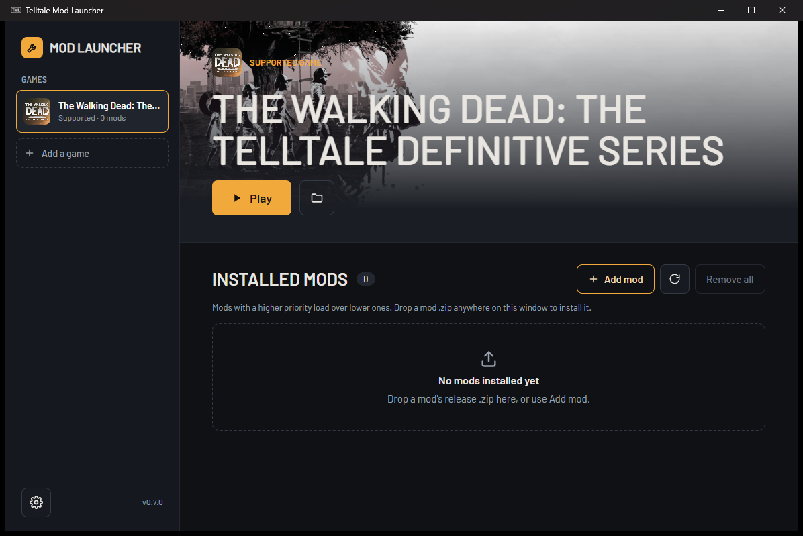

After I made the [Season 2 Rewind mod](/projects/twd-season-2-rewind/) I wanted it to work with the [Telltale Mod Launcher](https://github.com/Telltale-Modding-Group/TelltaleModLauncher), the launcher the Telltale Modding Group uses for The Walking Dead Definitive Series. Its last release was 0.6.5. It was a .NET Framework 4.7.2 WPF app, and it depended on a `LibTelltale.dll` that was never in the repo, so it couldn't build from a clean clone.

So I forked it and rebuilt it. Credit for the original goes to David Matos ([frostbone25](https://github.com/frostbone25)) and the Telltale Modding Group.

[Fork and release on GitHub](https://github.com/infernokun/TelltaleModLauncher/releases/tag/v0.7.0)

## What changed

The new launcher is .NET 10 with Avalonia, so the same code runs on Windows and Linux. A Steam copy of the game on Linux is started through Steam, so it runs under Proton.

- Your games sit in a sidebar. The selected game shows at the top with its own icon, read straight out of its exe, and Steam's cached artwork behind the title.
- Drop a mod's zip anywhere on the window to install it.
- You can set up more than one game.
- Light and dark themes.

The code is split into a core library with no UI in it (settings, Steam lookup, install, scan and remove) and the Avalonia app on top. There are 87 tests, including headless render tests that draw every window with the real styles.

## The bugs that were losing mods

The upstream repo had two open issues: mods disappearing after a restart, and a mod that installed but did nothing. Reading the 0.6.5 code turned up four causes:

- **A file watcher race.** The old launcher rescanned Archives whenever a `.json` appeared and deleted any mod with missing files. Graphic Black Disabler's zip lists its info file before its archive, so the rescan could fire halfway through an install and delete the mod.
- **The game name.** Almost every published mod says it's for `The_Walking_Dead_Definitive_Edition`, which wasn't in the launcher's game list. The first mod got through because the check was skipped when nothing was installed yet. Every mod after it was rejected.
- **macOS junk.** One mod's zip has `__MACOSX/._*` files. The old launcher picked the last `.json` in the zip, which was one of those, so adding the mod failed.
- **Flattened paths.** Mods may list files in subfolders. The old launcher dropped the folders, then counted the files as missing and deleted the mod at startup.

The new one has no watcher, stages every install in a temporary folder before touching anything, flags missing files instead of deleting them, and skips junk.

## Testing on a real install

I wrote the first version and tested it on Linux. When I pulled the branch onto my Windows PC and ran it against my real Steam install, two things showed up:

- A test compared a path built with `/` against the `\` path Windows returns.
- Saving settings failed now and then with "access denied". Antivirus, the search indexer and sync tools like Syncthing open a newly written file for a moment, and Windows won't replace a file while it's open. In a loop of 2000 back-to-back saves, 174 failed. File moves and deletes now retry for up to about 0.4 seconds, and the same loop runs clean.

Installing my own rewind mod also showed the old launcher copying every file in a zip into the game folder, including my install scripts and README. Now only the files a mod's info json lists are installed, plus any archive or resource file it forgot to list, so older sloppy mods still work.

## Load order you can drag

The game decides which mod wins a shared file by the priority in each mod's `_resdesc_*.lua`. The old launcher showed that number but couldn't change it, because most of those files are encrypted and the code that handled them lived in the missing DLL.

I ported Telltale's Blowfish variant from ttarchext into C#. It's standard Blowfish with a few P-array entries swapped and one S-box entry byte-swapped. Re-saving a file that ttarchext encrypted gives back its exact bytes, and every one of the 184 descriptors in my install decrypts.

Now the list is the load order. Drag a mod up or down, or use Move up and Move down in its right-click menu, and the launcher rewrites `set.priority` in the mod's files so the game agrees. The numbers the mods already use get handed out again in the new order. The priority in a mod's info json is treated as the author's suggestion, and updating a mod keeps the place you gave it.

The screenshot at the top is my real install: Season 2 Rewind dragged above Graphic Black Disabler. I swapped them back and forth through the launcher, and ttarchext read the new priorities straight out of the encrypted files each time.

## Getting it

The [0.7.0 release](https://github.com/infernokun/TelltaleModLauncher/releases/tag/v0.7.0) has a Windows zip and a Linux tarball. Both are self-contained, so there's nothing else to install. The work is also open as a pull request on my fork.
