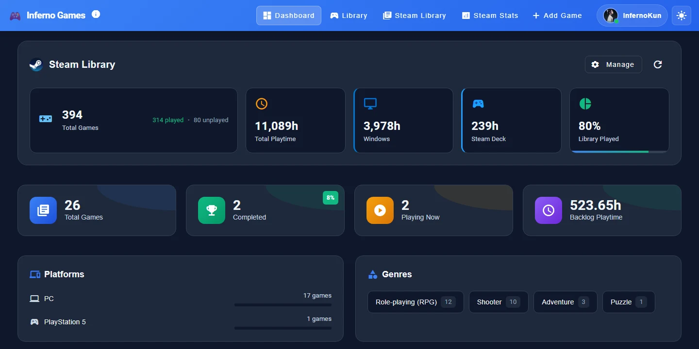
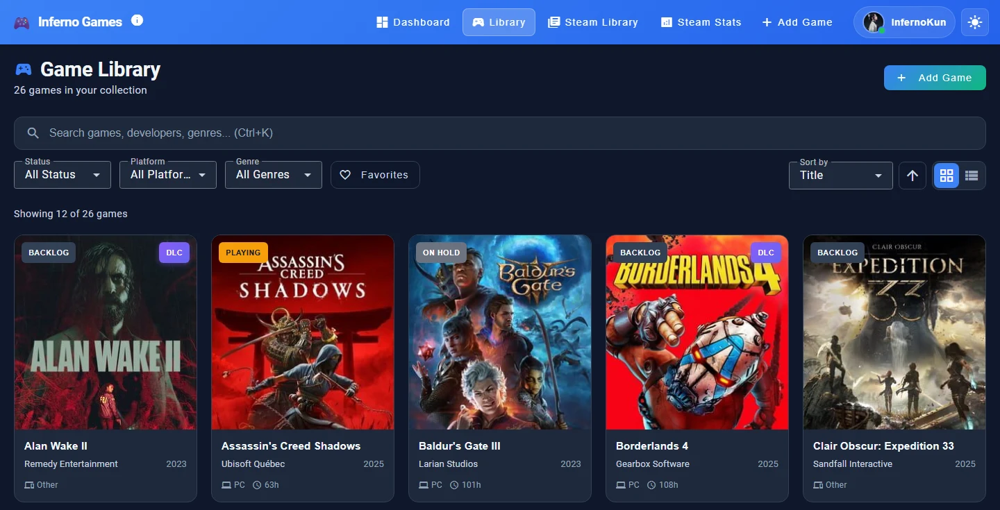
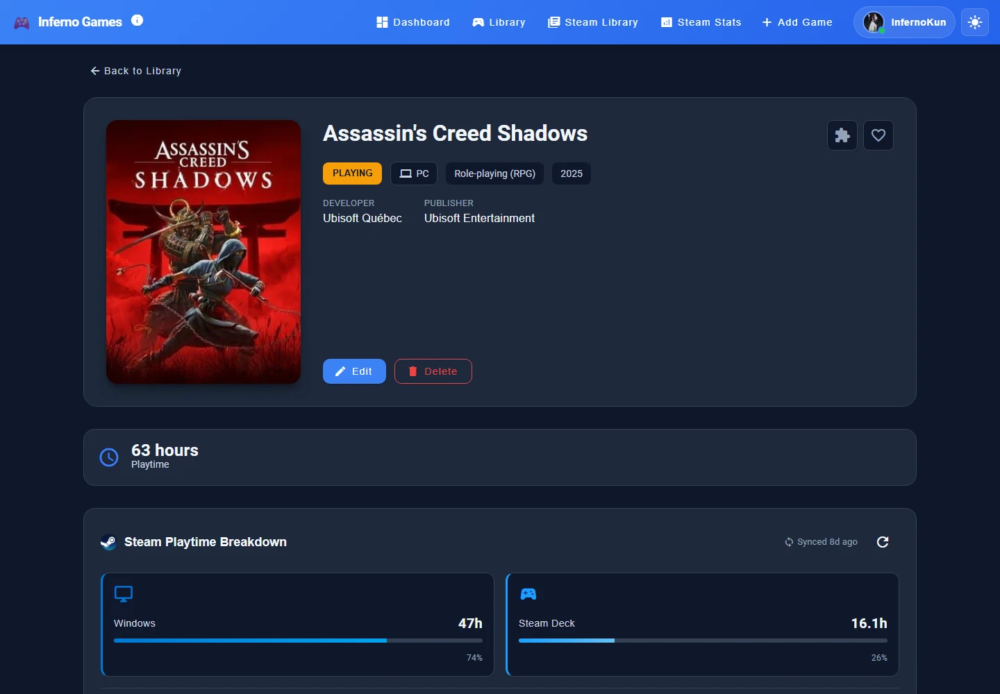
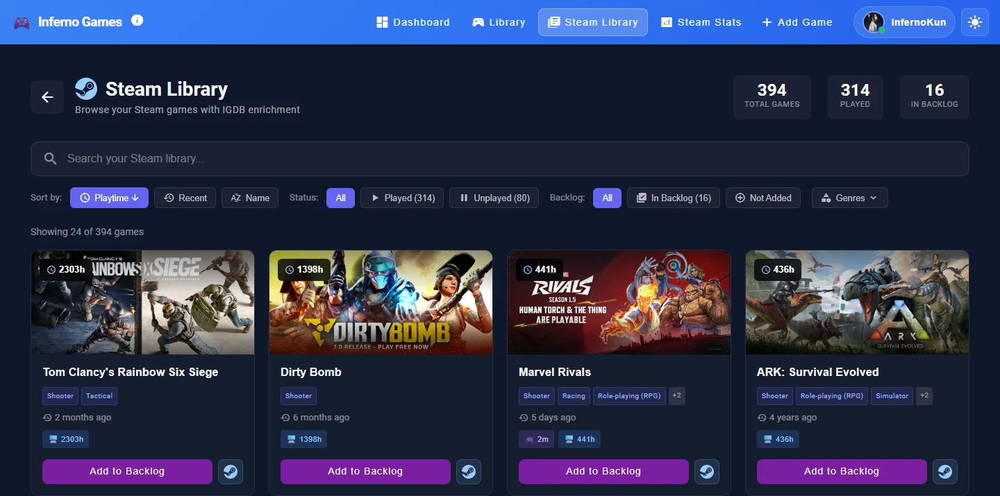
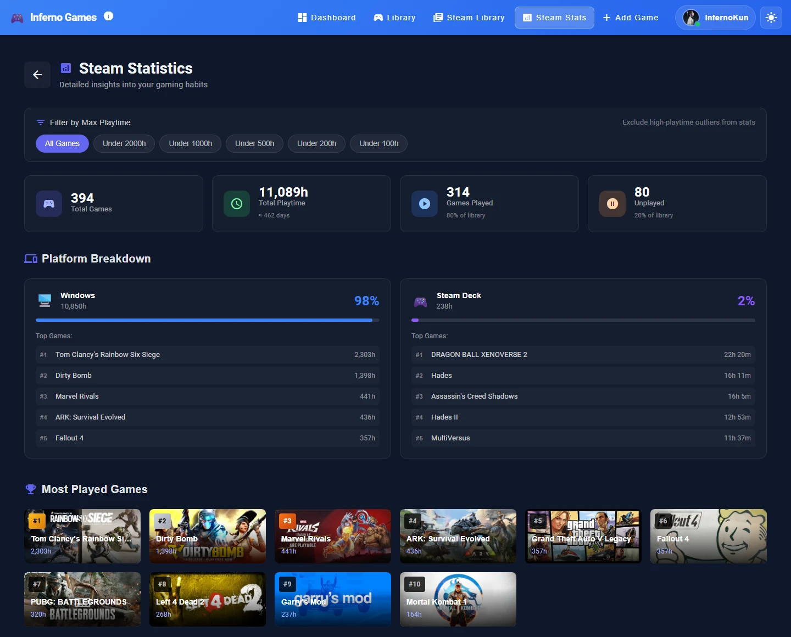

Inferno Games keeps track of the games I own, what I'm playing now, and my backlog. It pulls in my whole Steam library and splits playtime between my Windows PC and my Steam Deck.

It runs on my home server alongside [Inferno Comics](/projects/inferno-comics/). The source is private, and these screenshots are from my own instance.

## The library

Games I'm tracking each get a card with their status (backlog, playing, completed, on hold or dropped), the platform, the developer and year, and how long I've played. Some cards also carry a DLC tag. Filters cover status, platform and genre, with favorites and a few ways to sort.

Each game has its own page. For Steam games, it shows the playtime split between Windows and Steam Deck, synced from Steam, next to the buttons to change its status.

## The Steam side

The Steam Library page lists every game on my Steam account, enriched with data from IGDB. It can sort by playtime or by when I last played, filter played and unplayed games, and add any of them to the backlog in one click.

Steam Stats is the big picture: 394 games, about 11,000 hours in total, and how much of the library I've actually played. The platform breakdown shows my top games on PC and on the Deck, and a filter can drop the outliers with thousands of hours so they don't swamp everything else.

The Steam Deck numbers are a nice pair with [SyncDeck](/projects/syncdeck/), which keeps those games' saves synced to the same PC.
