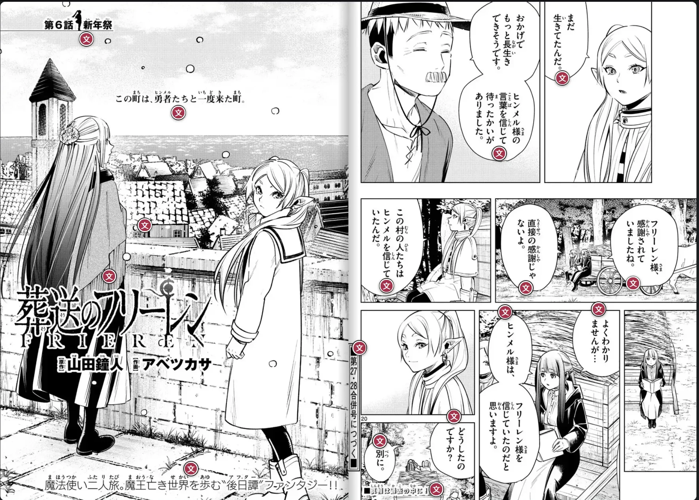

Inferno Nihongo turns real Japanese, like manga, light novels and screenshots, into study material. Point it at a page, read it with help, and the words you looked up come back for review. No generic decks: you review the words you actually met.

It's live at [japan.infernokun.com](https://japan.infernokun.com/), free to try while it's in evaluation.

## Scan


### Photograph any page

Upload a photo, a screenshot, a PDF or a CBZ. OCR finds the text, including vertical text, rotated pages and speech bubbles, and rebuilds it as real text with the reading order fixed.

### See what it found

Real scans are messy, so before anything is saved every word is boxed on the image. Drop false positives, fix a reading, and tune how eagerly nearby boxes merge into one speech bubble. Furigana is left out by default, because those little reading aids get swept into the text and ruin it.


## Read

Once a page is in your library, every speech bubble it found gets a marker.


nihongo-bubble-popup.webp | Tap a marker and the bubble opens as real text, with furigana over the kanji
nihongo-page-popups.webp | Open as many as you like and read the page that way



### Tap any word

A tap shows the reading, meanings, the conjugation broken down (dictionary form plus passive plus past, and so on), JLPT level, frequency rank, WaniKani progress, the kanji with their readings and parts, example sentences, and where else in your library the word shows up.

Words you've saved are underlined green. Words saved from a different series show orange, so your vocabulary follows you from book to book.



### Novels too

Text-heavy pages get a page reader instead, with furigana above only the kanji you don't know yet.

The pages down the side are photos of the physical book, each one turned into text you can tap.


## Remember


### Review what you met

Saved words go into spaced-repetition review. If you already know a word you can mark it known right from the reader.

A built-in getting-started book walks through all of this, including how a scan is reviewed.


## How it's built

It's four services, all in Docker:

- **Web:** Angular 22 with TypeScript and SCSS.
- **API:** Spring Boot 3.5 on Java 25, with PostgreSQL and Redis. The Japanese analysis lives in its own Gradle module, `hibana` (火花, "spark"): the tokenizer, bundled JMdict, JMnedict, KANJIDIC2 and Tanaka data, and the dictionary ranking, with no database, HTTP or auth in it.
- **Translate:** a Python FastAPI service for OCR, furigana, translation, and rendering pages out of PDFs and CBZs.
- **Mobile:** a Flutter app for Android and iOS on the same API, with an offline mode.

My own GitLab builds and tests everything and pushes the images to my own registry. Next to test coverage for each service, the pipeline reports a reader accuracy score and an answer accuracy score, so a change that makes either one worse shows up before it ships.
