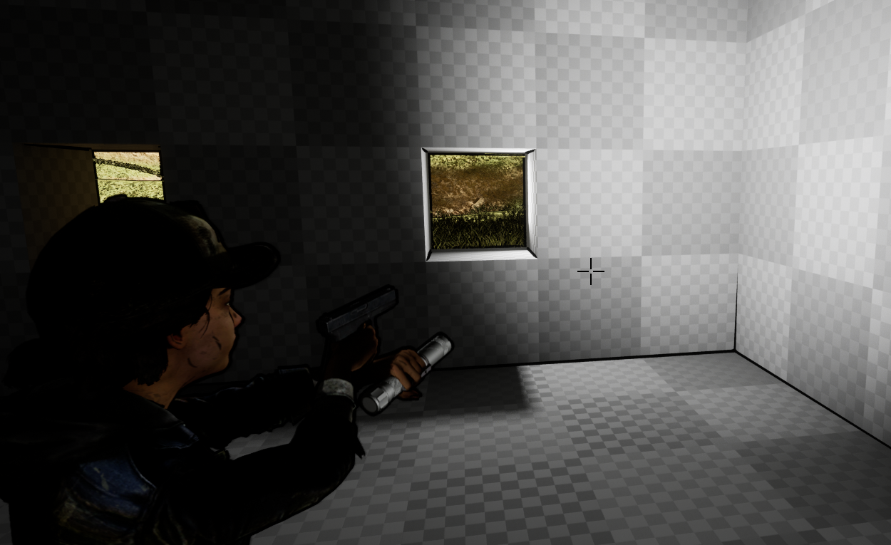
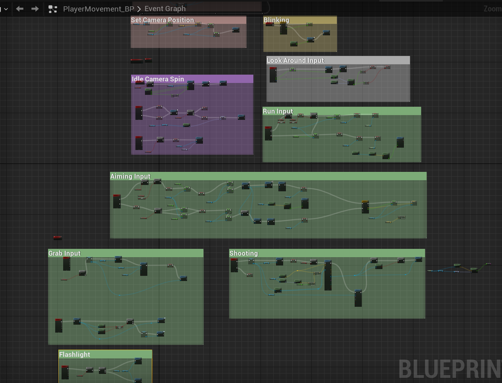
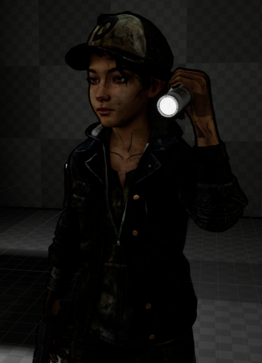

Project TTG is a work-in-progress game in Unreal Engine, built around a Clementine model from Telltale's The Walking Dead. It borrows from two places: the point and click style of Telltale's adventures, and the third-person feel of the Resident Evil remakes.

It's purely for learning, with no plans for any kind of release. Everything here lives in a grey-box test level, because the point is getting the systems right, not content.

<video src="clementine.mp4" poster="clementine-poster.jpg" muted playsinline loop autoplay controls></video>

## Third-person gameplay

From the Resident Evil remakes it takes the camera over the shoulder, a flashlight that matters, and careful movement. In a full game that style also means limited resources and puzzles built into the environment.

## Blueprints

The gameplay logic is built in Blueprints, Unreal's visual scripting. Events, functions and interactions with the world are all wired up there, which makes it quick to try an idea without writing C++ first.

## Control Rig

The character animation goes through Control Rig, Unreal's node-based tool for building skeletal controls and animating them procedurally. It lets the character react to the world instead of only playing back canned animations.

Control Rig setups can be packaged as Control Rig Blueprints, so the same setup can be reused and configured across characters.

## The Clementine model

Getting Clementine into Unreal meant setting up the model, rigging it, and getting it animating. With Control Rig driving her, I could clone existing animations and adjust them instead of animating everything from scratch.

